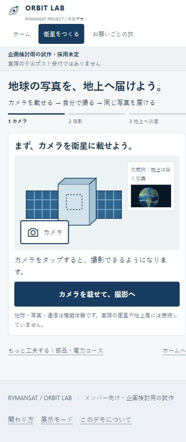
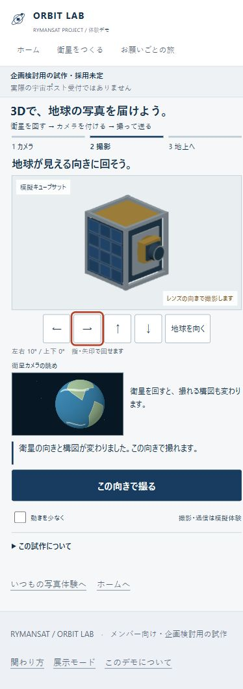
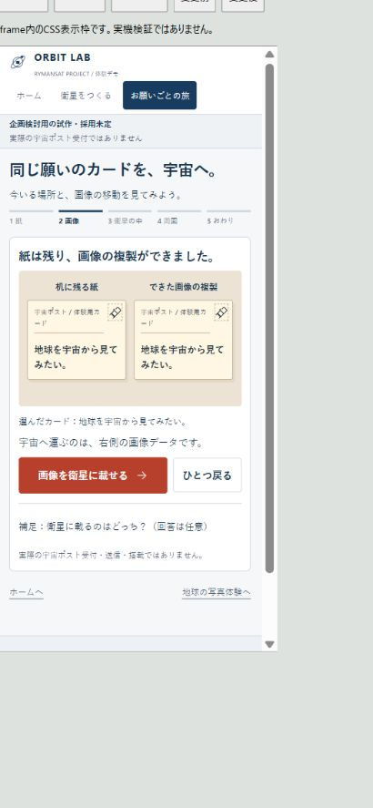
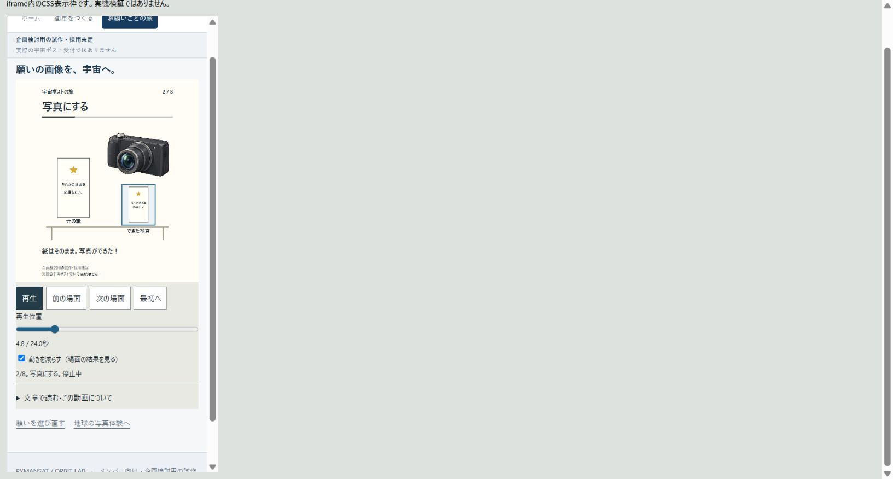
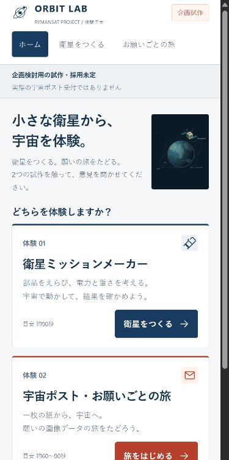
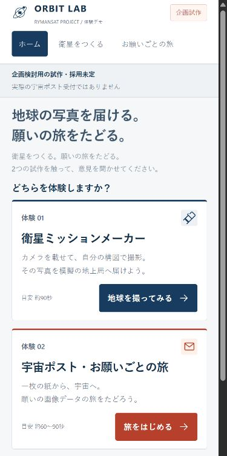
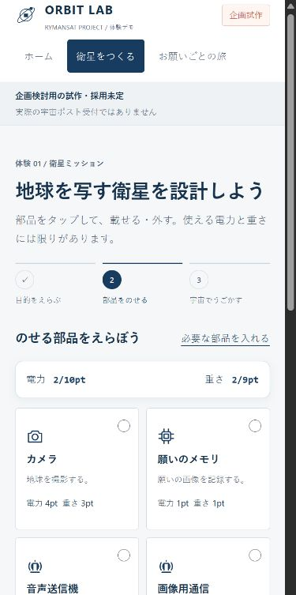
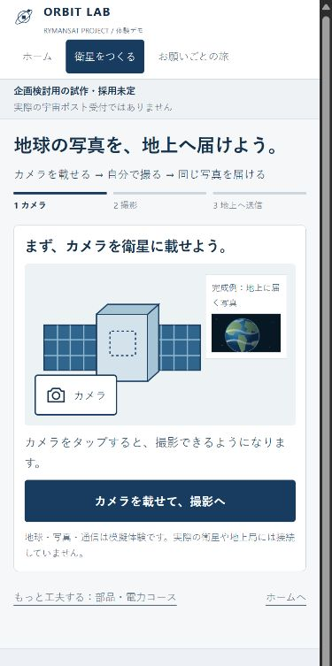
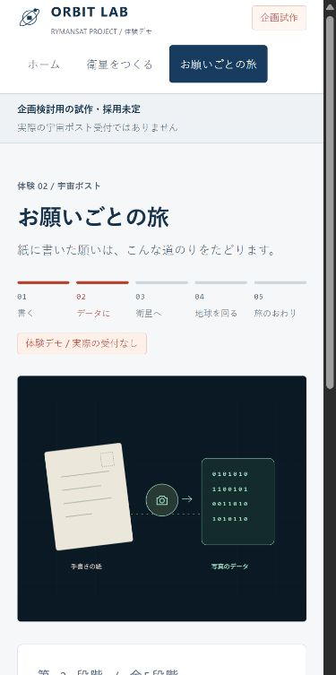
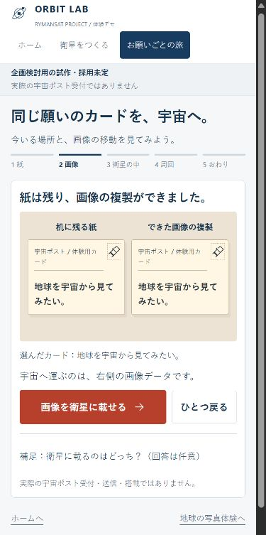

# 検証記録

## OPPO Reno11 Aでの実機確認（2026年10月30日）

- 対象commit：`b40ec7245d8c0bbaa0ffd8a1b45455e029da864f`（3D実装は `76e91546d3fa9e6f3aae4d01979b6b459c2cfd6c`）。この追記ではアプリ本体を変更していない。PR #4の専用ブランチをUSB経由のローカルHTTPで確認し、mainへのマージ・Pages公開は行っていない。
- 実機：OPPO Reno11 A、端末model `CPH2603`、Android 16、Brave `1.97.59`。端末1台での確認であり、他のAndroidやiPhone/Safariまで確認済みとは扱わない。
- USBのADB/scrcpy経由で実機のAndroid/Braveを操作した。3D描画・JavaScript・画像生成は実機上で動作しており、PCの画面サイズ変更による代用ではない。タップ・タッチドラッグはPCから注入した操作で、手持ちでの指の操作感・押しやすさの評価とは区別する。音声・クリップボード同期を無効にし、端末の文字・表示密度・セキュリティ設定は変更していない。
- 物理解像度1080×2412px。端末から読み取った密度はphysical 480 / override 540、文字倍率1.15。別のローカル診断ページで `innerWidth=320`、`innerHeight=534`、`devicePixelRatio=3.375`、`visualViewport.width=320`、`height≈590.81`、`scale=1` を観測した。ブラウザの上下バーの状態で高さは変わる。写真・動画のピクセル数をCSS表示領域と混同しない。スクリーンショットは縮小ミラーのWindowsウィンドウ477×1093pxであり、端末の原寸キャプチャではない。

| 確認 | 実機で観測した結果 |
|---|---|
| 3Dの起動とカメラ | 衛星と地球の3D表示が起動。立体の外にあるカメラをタップすると衛星に取り付き、撮影できる状態になった。 |
| タッチによる回転 | キャンバス内のタッチドラッグで左右20.7°・上下−10.4°へ変化し、衛星本体とカメラの眺めが変わった。「地球を向く」ボタンで0°/0°に戻った。PCのミラー上のドラッグが反映しない試行は合格に含めず、Androidへのタッチ入力で再確認した。 |
| 撮影・受信・撮り直し | 20.7°/−10.4°で撮影→受信、撮り直し→0°/0°へ変更→再撮影・受信。2構図は見た目が変わり、各回とも衛星側・地上側に同じ見た目の画像が表示された。実機の画像src/PNGバイト列の比較は行っていない。データの完全一致は前日のPCブラウザ・状態テストの範囲として区別する。 |
| 動き低減と連打 | 子画面の動き低減をオンにして装着ボタンを短い間隔で2回タップしても、自動撮影せず撮影前で止まった。撮影後の送信を2回タップしても、受信状態を保持して勝手に撮り直しへ進まなかった。 |
| 再読み込み・中断・戻る | Braveのメニューから再読み込み後、写真が消えて装着前・動き低減オフへ戻った。通常の送信を開始して約0.15秒後にホームへ移動し、1.3秒後もホームが正常表示。Androidの戻るで3Dへ戻ると装着前になり、旧画像・送信結果を引き継がなかった。 |
| 既存写真体験 | カメラ装着→左矢印で構図変更→撮影→地上受信を確認。撮った構図と受信画像が見た目で一致。「別の構図で、もう一度撮る」で構図調整へ戻った。実機での2回目の再送完了までは確認していない。 |
| 宇宙ポスト | 「だれかの挑戦を応援したい。」を選び、短冊の文面変更を確認。再生から約25秒後、8/8の最終場面と「宇宙へ行くのは、短冊の画像。」が表示され、「最初へ」で1/8に戻った。全フレームを画像比較した検証ではない。 |
| 放出ゲーム | 通常速度で打上げ→周回成功95点。再挑戦を早く放すと「早かった！大気の中へ。」になり、再挑戦ボタンが表示された。 |
| 表示・スクロール | 確認した画面に文字・操作の欠落や横はみ出しは目視で見られなかった。この320 CSS px・文字倍率1.15の設定では、目的・衛星・撮影ボタンが初画面に同時には入らず、3Dと既存体験の主要操作に縦スクロールが必要。スクロール後は操作できた。実機でscrollWidthの数値測定はしていない。 |

画面：[3Dの初画面](images/oppo-3d-initial-20261030.png) / [回転と構図](images/oppo-3d-aim-20261030.png) / [受信A](images/oppo-3d-received-a-20261030.png) / [別構図の受信B](images/oppo-3d-received-b-20261030.png) / [既存写真](images/oppo-mission-complete-20261030.png) / [宇宙ポスト最終場面](images/oppo-post-complete-20261030.png) / [ゲーム成功](images/oppo-release-success-20261030.png) / [早期放出](images/oppo-release-retry-20261030.png) / [戻る後](images/oppo-3d-back-initial-20261030.png) / [表示領域の診断](images/oppo-viewport-20261030.png)

残る確認：手持ちでの指の操作感、文字拡大・小さい表示領域でのスクロール量、初見の理解・面白さ、読込時間・FPS・温度・消費電力の定量測定、会場回線、画面回転・マルチタッチ・支援技術、別アプリからの復帰、OSの動き低減の実切替、他のAndroid/iPhone/Safari。Androidのコンソール・Networkの詳細ログは採取していないため、実機でJavaScriptエラー・404が0件とは断定しない。前日の出所不明のMutationObserver例外も、この実機確認で解消扱いにはしない。

---

## 3Dキューブサット写真試作（2026年10月29日・PRレビュー用）

- 実装・検証対象commit：`76e91546d3fa9e6f3aae4d01979b6b459c2cfd6c`。この節は後続の検証記録commitで追加。
- 改修前main：`9f00059f309ae1ea05787dea4b89fcef1466d96b`（PR #3反映後）。専用ブランチ `codex/cubesat-3d-prototype`。この追加試作は未マージ・本番未公開で、main・Pagesの設定は変更していない。
- 移管元は提供HTML v0.1。Sites現行版との同一性は未確認のまま。既存3体験の構成・操作・判定は維持し、別入口 `#cubesat3d` にThree.jsの追加試作を置いた。今回許可された3D描画以外の大規模な技術変更はない。
- 環境：Windows 11、Codex内ブラウザ、Node.js 24.14.0、Python 3.11.9。ローカルHTTPの `/rymansat-orbit-lab/` 配下で確認。3サイズは**測定したiframeのCSS表示枠**390×844・360×800・1440×900。親本文幅はスクロールバーを差し引いた375・345・1425px。スマホ実機の結果ではない。
- 比較画面は追加でブラウザ表示領域を390×844と1440×900に設定して取得した全ページ画像。390幅の直接表示では `innerWidth=390 / innerHeight=844` を確認。全ページ画像の高さ・ピクセル数を表示領域の測定値と混同しない。仮の表示サイズ設定は確認後に解除した。

| 確認 | 結果と範囲 |
|---|---|
| ホーム | 全3サイズで既存3入口と追加3D入口があり、横はみ出しなし。既存3カードの配置は維持し、追加試作はその下に置いた。 |
| 3Dの開始・完了・再挑戦 | 全3サイズでカメラ装着→ボタンで回転→撮影→同じ画像を地上で受信→撮り直し→別構図で再受信。撮影後の回転は固定され、撮り直しで解除。390幅では目的・衛星・主要操作が通常の表示枠内に入る。 |
| 実際の写真変化 | 2つのThree.js描画を使い、本体と撮影カメラの姿勢を共有する。実ブラウザのPNG A/Bは別の構図・別のデータになった。3サイズすべてで受信画像srcと撮影画像srcが完全一致。写真A/Bは下記に保存。状態テストの模擬画像を、この実描画の証拠として使っていない。 |
| 指・キー・ボタン | ドラッグで左右24.5°・上下−7°へ変化。矢印ボタン、キャンバス上の矢印キー、主要操作のEnterを確認。「地球を向く」で正面へ戻せる。カメラ装着は主ボタンで確認し、立体部品自体のタップ判定は別途実機で確認する。 |
| 連打・動き・中断 | ダブル操作で装着後の自動撮影・撮影後の自動送信が起きない。装着・送信をスキップ可能。全体の動き低減が子画面へ反映され、強制された低減を子で解除できない。送信中の説明ダイアログでreviewへ戻り、写真を保持し受信は取り消す。装着中断後は装着済みの姿へ描画する。 |
| 移動・再読み込み | 送信中にホームへ移動しても旧画面の結果が混入しない。ブラウザの戻るで装着前へ初期化し、再読み込みも装着前になる。自動テストで古いタイマーと破棄後通知を抑止。BFCacheの実際の復元、別アプリからの復帰は未検証。 |
| 待機・リソース | 待機500msでキャンバスの描画回数が増えないことを全3サイズで確認。描画は操作・リサイズと短い装着演出中だけ行い、離脱時にgeometry/material/texture/rendererとWebGL contextを解放する。解放後のGPU使用量・バッテリー・発熱は計測していない。 |
| 表示不可 | テスト配信コピーでモジュール読込失敗、WebGL context lossをそれぞれ起こした。偽の写真は作らず、開始不可／表示中断の日本語と、読み直し・既存写真体験への経路を表示。実際の非対応端末は未検証。 |
| 文字200% | 子画面のCSS基準文字を16→32pxにした公開対象外の配信コピー。説明を展開すると高さ1793pxへ伸び、内容・ボタンを縦スクロールで読める。横幅343pxに対しscrollWidth343px。OSやSafariの文字拡大機能を操作した結果ではない。 |
| 既存写真の回帰 | 全3サイズで装着・撮影・受信・撮り直し・再受信。2つの構図は別データになり、2回とも受信srcは撮影srcと一致。横はみ出しなし。 |
| 宇宙ポストの回帰 | 全3サイズで例文0/1/2を1つずつ選び、8場面→最終見出し「宇宙へ行くのは、短冊の画像。」→24秒→最初へ0秒を確認。横はみ出しなし。今回は場面送り・スライダーで確認し、24秒連続再生の再測定ではない。 |
| 放出ゲームの回帰 | 全3サイズで打上げ→周回成功94/94/95点→再挑戦→早期再突入を確認。親・子とも横はみ出しなし。ゲームの判定は変更していない。 |
| 任意の部品・電力コース | PCで写真・願い・声の3目的を確認。写真の同時実行は電力不足、順次実行への再試行は成功。願い・声の同時実行は成功。 |
| 3D自動テスト | `node scripts/test-cubesat-3d.cjs`：15件PASS。姿勢の有限性・範囲、不正遷移、撮影後固定、同一PNG受信、撮り直し、350msガード、スキップ、中断、古いcallback、動き低減、失敗、破棄、親子通信、固定配布物ハッシュを検査。キャプチャ・タイマーは模擬。 |
| 実Three.jsの計算 | `node scripts/test-cubesat-camera.mjs`：正面・背面・左右・上下への投影と、360姿勢の本体／レンズの向きの一致がPASS。同梱の実ライブラリを使うが、このテスト単体はGPU描画のテストではない。 |
| 既存自動テスト | 写真16＋ポスト連携7、ポスト8場面・721時点・3例文・連打・動き低減・フォーカス、放出ゲーム19件がPASS。既存判定に変更なし。 |
| 素材・構文・配信 | HTML内のJS、新規と既存JSの構文PASS。Pagesと同じ接頭辞で24配信ファイルがHTTP200かつローカルのバイト列と一致。3D用の外部素材・CDN依存なし。公式npm配布のThree.js 0.186.1をMIT表示・元配布物のSHA-256/SHA-512記録とともに同梱。 |
| ブラウザログ | 新しい検証タブで3D単体と埋め込みの開始→撮影→受信を確認し、警告・エラー0件。別タブの再読み込み確認では出所URLのないMutationObserver.observe例外を1件記録した。配信ソースに同APIの利用はなく、通常フローでは再現しないが、検証環境由来とは断定していない。実機ブラウザでも確認する。意図的な読込失敗・context lossの試行は通常ログと分けた。 |
| 公開対象 | 対象差分とファイル一覧を確認し、秘密キー・個人メール・認証・旧公開先URLのパターン検出なし。ローカルの生ログ・テスト配信コピーは管理外。自作部分のdiff whitespace検査PASS。Three.js元配布物の空白警告1箇所は、原本のハッシュを保つため改変していない。 |

画面・画像：

| 変更前：既存写真体験 | 追加後：3Dで構図を調整 |
|---|---|
|  |  |

[地上で同じ写真を受信](images/cube-received-390.png) / [PC表示](images/cube-after-1440.png) / [文字200%](images/cube-text-200.png) / [実際の写真A](images/cube-photo-a.png) / [違う向きの写真B](images/cube-photo-b.png)

未検証：実機iPhone/Android、Safari/Brave固有動作、WebGL 2非対応機器、初回読込時間、低性能端末での応答、長時間運用・発熱、実際のOS文字拡大・動き低減変更、画面回転・マルチタッチ・スクリーンリーダー、BFCache復帰、初見の人の理解・面白さ。機能のPASSからこれらを断定しない。[3Dの約3分の実機チェック](device-checklist.md)を用意した。

公開は所有者の別途承認後。承認時はmainへの取り込みとPages反映、配信バイト列、公開URLで4つの入口・体験を確認する。不具合時は上記の改修前mainを基準に、通常のrevertブランチとPRで戻す。force push・mainのreset・既存Sitesの変更を行わない。

---

## 衛星放出タイミングゲームの追加（2026年10月17日・公開前）

- 実装・検証対象commit：`a74f0ce4585fd090af48f0b8504942f03a03f430`。この検証記録の追記は後続の文書commit。
- 改修前main：`b3a6ed60d4f3fa5693ee79ccae4083e9be8d1d53`（PR #2公開済み）。専用ブランチ `codex/satellite-release-game` のレビューであり、新ゲームは本番未公開。mainへのマージ・Pages反映は別途承認後。
- Windows / Brave / Node.js 24.14.0、ローカルHTTPのサブディレクトリ配信で確認。390×844・360×800・1440×900は**測定したiframeのCSS表示枠**。ブラウザ全体のリサイズ・実機ではない。Windowsのスクロールバーを差し引いた親本文幅は370・340・1420px。画像は実際のブラウザ表示から切り出した参考画像で、表示倍率・ブラウザの外枠の影響を受ける。画像のピクセル寸法をCSS表示枠の測定値としない。
- 移管元は提供HTML v0.1、Sites現行版との同一性は未確認。既存2体験は維持し、3つ目として創作ゲームを追加。今回のゲーム判定を科学的な軌道・実機動作と混同しない表示を保持する。

| 確認 | 結果・範囲 |
|---|---|
| 新ゲームの3サイズ | 各枠で打ち上げ→放出→地球周回97点→再挑戦→早期再突入を確認。親・子とも横はみ出しなし。図、目的、計器、主要操作が見える。 |
| 分岐とフィードバック | 実際のボタン・Enter操作で、早期再突入、周回成功、漂流、月、太陽、放しそびれを観測。放した位置を◆で残し、次は早める/待つという文を表示。成功帯は再挑戦ごとに変わる。タイミングがずれた試行も正しく早い・遅いになった。 |
| 状態と入力 | 素早い2操作で勝手に放出しない。一時停止後は針が進まず、明示再開で継続。結果演出をスキップできる。説明ダイアログを開くと飛行を停止。ホーム移動→ブラウザで戻ると新しい画面・挑戦0回になり、古い演出を引き継がない。再読み込みでも初期化。 |
| 動き・キーボード | ゆっくりモードとEnterで周回成功。全体の動き低減が子画面に反映され、強制設定を子画面で解除できない。低減では計器を残して結果演出を即時表示。キーリピート・端末の設定変更イベントは模擬DOMで検証。実際のOS設定操作とは区別する。 |
| 文字拡大 | 子画面のCSS基準文字を16→32pxにした検証用配信コピーで確認。親の埋め込み高さが1078px、説明を開くと1704pxへ伸び、横はみ出しなし。親を縦にスクロールして読む。OSの文字設定変更ではない。 |
| ホーム | 390×844で既存の2開始ボタン下端は536px・757px。新ゲームはその下の3枚目（下端978px）。最初の2つの入口を維持した。 |
| 写真体験の回帰 | 全3枠で開始・受信・構図変更・再受信。構図変更で画像srcが変わり、2回とも受信srcが撮影srcと一致。横はみ出しなし。 |
| 宇宙ポストの回帰 | 全3枠で例文選択→8場面→24秒到達→最初へ0秒。例文0/1/2を枠ごとに選択。全8場面の見出しと横はみ出しなしを確認。今回の回帰は場面送り・スライダーで行い、連続24秒再生の再測定ではない。 |
| 部品・電力コース | 3目的を確認。写真の同時実行は電力不足、順次実行へ変更した再試行は成功。願い・声は同時実行で成功。 |
| 自動テスト | `node scripts/test-release-game.cjs`：19シナリオPASS。100回分の狙う帯と両端・中心、6判定、フレーム間隔差、1回だけの放出、タイムアウト、停止再開、得点保持、ゆっくり、連打、フォーカス、非表示・離脱、親子通信のorigin/source/channel・高さ制限を検査。描画とイベントは模擬DOM/RAFで、実ブラウザ確認と区別する。 |
| 既存の自動テスト | `node scripts/test-experience.cjs`：写真16＋宇宙ポスト連携7シナリオPASS。`node scripts/test-spacepost-flow.cjs`：8場面・721時点・3例文・無効入力・同一画像・座標・完了・seek・構文、動き低減・フォーカス・連打PASS。複数messageリスナーを持つため、旧テストの「最後のリスナーだけ保存」をブラウザと同じ複数保存へ修正。 |
| 配信・構文・エラー | ルートHTMLのインラインJS、新ゲームJSの構文PASS。ルート＋既存と新規の14ファイルがHTTP200、配信バイト列と検証ソースが一致。素材404なし。取得した検証タブの警告・エラーログ0件。新ゲームは画像・外部依存の読み込みを追加しない。 |
| 公開対象の確認 | 変更ファイル一覧と差分、旧公開先URL・秘密キーのパターン検査を確認。設定・個人メール・認証・会話ログ・ローカル検証記録をstageしていない。Git作者はリポジトリ内のnoreply設定。 |

画面：[変更前ホーム](images/release-before-home-390.png) / [変更後ホーム](images/release-after-home-390.png) / [新ゲーム390幅](images/release-game-390.png) / [周回成功](images/release-success-390.png) / [PC](images/release-game-pc.png) / [文字拡大](images/release-text-200.png)

未検証：実機iPhone/Android、Safari、OSの文字サイズ・動き低減設定の実操作、支援技術、会場回線、長時間展示、初見の家族の理解・面白さ・難易度。機能のPASSを評価の代用にしない。[約3分の実機チェック](device-checklist.md)を追加した。

採用・公開後はこの改修前mainを復旧基準として、通常のrevertブランチとPRで戻す。reset・force pushを使わない。今回の作業ではmain、既存Sites、招待・課金・認証設定を変更しない。

---

## PR #2：宇宙ポストへの8場面版組み込み（2026年10月17日）

- 検証対象の実装commit：`eb8dc2baee13b502ea2341a63a45067cda7fba96`。本節の追記と末尾空行の整理はその後の文書commit。
- `animations/spacepost-flow/deck.html` SHA-256：`531b72143446368da06dd558115db1b80707b51930cc82b656cbb45efe57e2fb`。制作元は承認されたレビュー版v4.0（24秒・8場面）。GitHub版へ選択例文・画面移動・動き低減連携を追加した。移管元HTML v0.1およびSites現行版との同一性は未確認のまま。
- 宇宙ポストの例文選択後の主画面を、5段階から24秒・8場面のプレイヤーへ変更。選択した3例文を同じ短冊の画像として使い、原本の紙は地上に残す。任意の部品・電力コースと写真体験のルールは維持。
- 環境：Windows 11、Brave、Node.js 24.14.0。ローカルHTTPでPagesと同じ`/rymansat-orbit-lab/`の接頭辞を使用。画面確認はiframeのCSS表示枠390×844・360×800・1440×900で実施。ブラウザ全体のサイズ変更や実機での結果と混同しない。表示領域変更APIの指定値と実測が一致しなかった試行は、寸法検証の証拠に採用していない。

| 確認 | 結果・範囲 |
|---|---|
| スマホとPC | 3つの表示枠で両体験の開始・完了・再挑戦を確認。親画面とプレイヤーに横はみ出しなし。通常表示では図・現在の見出し・主要操作が同時に見える。390幅と360幅のホームの2開始ボタンも表示枠内。 |
| 写真体験 | 各表示枠で2回撮影。構図を変えるとsrcが変わり、地上受信srcは撮ったsrcと一致。PCは矢印キーとEnterでも操作。 |
| 宇宙ポスト | 全3例文を表示枠ごとに選択し、文章版の文面一致を確認。各枠で全8場面の結果と最初へを確認。願いの選び直しも操作した。390幅で通常再生が24秒で完了。前後の場面、時間スライダーHome/End、Enter、連打ガードを確認。 |
| 状態・移動 | ハッシュ付きURLの直接表示と再読み込みは例文選択から開始。ブラウザの戻る、通常再生中のホーム移動、再訪で古いプレイヤーが残らず再開可能。全体の動き低減が子画面へ反映され、チェックがオン・解除不可となり再生を停止。 |
| フォーカス | 最初の場面で前ボタンが無効になる際は次へ、最後で次が無効になる際は最初へ移ることをブラウザでも確認。 |
| 既存コース | PCで3目的を完走。地球撮影のまとめて実行で電力不足、順次実行へ変えた再試行で成功。 |
| 文字拡大 | 主要文字を約2倍（操作28px・親見出し40px）にした検証用コピーを390×844枠で操作。縦スクロールを許し、8工程の文章と操作を読めた。親・子とも横はみ出しなし。OSの文字サイズ変更ではない。Canvas自体の文字拡大を保証する検証ではなく、全文は文章版で確認する。 |
| 自動テスト | `node scripts/test-experience.cjs`：16コア＋7親子画面連携シナリオPASS。`node scripts/test-spacepost-flow.cjs`：8境界・721時点・3例文一致・無効入力拒否・座標・周回・完了・順不同seek・構文がPASS。プレイヤーのイベント処理を使った模擬DOMで、動き低減の優先関係、無効化時のフォーカス、連打とガード経過後の復帰もPASS。 |
| 独立レビュー | 動き低減の上書きと無効化時のフォーカスの2指摘を修正し、再レビューで指摘残なし。模擬DOMで素材読込を失敗させ、エラー表示・全操作無効・場面が進まないことも確認。実際の回線遮断試験とは区別する。 |
| 描画・動画 | slide-hubの最終gateは規約・コントラスト・決定性・MP4・レビューパック生成がPASS。6時点×3描画順で不一致0。24秒・1080×1440・30fps・720フレーム、フラッシュ0・小さな明滅0。大きな変化7件は場面間の意図したカット。境界の前後0.3秒とコンタクトシートを確認。Canvas文字は自動コントラスト検査対象外。 |
| 素材・エラー | 配信対象10ファイルをHTTP 200で取得し、ローカルSHA-256と一致。アプリ由来のJavaScriptエラーを観測せず。検証ハーネスが自動要求したfaviconの404と、Zotero拡張機能由来の接続エラー2件はアプリの素材欠落・例外から分けた。新しい直接表示タブの警告・エラーは0件。 |
| 公開前検査 | 公開候補から旧公開先URL、個人メール、認証キー・トークンのパターンを検出せず。`.qa/`と`.local-handoff/`、検証用コピー、MP4はGit対象外。 |

### 変更前後

| 変更前：5段階の画像化 | 変更後：選んだ例文の8場面 |
|---|---|
|  |  |

[360幅](images/post-family-after-360.jpg) / [PC](images/post-family-after-pc.jpg) / [8場面](images/post-family-contact.png) / [放出境界](images/post-family-deploy.png)

### 未検証と公開境界

- 実機iPhone・Android、Safari、OSの動き低減・文字サイズ設定を実際に変える操作、低速回線、会場回線、長時間運用、支援技術による実操作は未検証。静止素材4点は計7,289,945 bytes（約7.3MB）で、初回読込時間は実機で確認する。
- 初見の小学生・中学生・家族・高齢者による理解、面白さ、テンポは未評価。機能テストを理解度の証明にしない。[約3分の実機チェック](device-checklist.md)を更新した。
- この更新はPR #2の専用ブランチに限定する。mainは`55b9649570ab57c9fd2f50d56f6ce65f31b8a5aa`のまま。マージ・本番公開は未実施で、承認後にPagesの配信内容を別途確認する。
- 今回の組み込み前のブランチcommitは`2ae4124efc50611d4ec378e688d35f58555c8986`。現行mainの改修前基準は`754bf877f440545eaa7545d2f1b1654694fbe0fc`。戻す場合は通常のrevertとPRを用い、force pushしない。

---

## PR #1の独立レビューと修正（2026年10月16日）

- レビュー基準: `604a0637eb31e8bb0d115c000ce7e4f321812580`。Claude Opus 5.5 APIへ公開ソース9ファイルのハッシュ固定パケットを送り、静的レビューを実施した。本文を得たパケットにはスキップのフォーカス修正案も含む。未変更の大きな図版・base CSSは省略したため、APIレビューだけで描画・配色・動き低減の網羅確認とは扱わない。
- 修正・再検証したアプリ: `bba5d4f50dc73bf28e487a5c8fa2809c0d76a8f7`。専用ブランチ `codex/experience-feedback`。main・Pagesは承認待ちで、下記はローカルHTTP版の結果。
- 復旧の基準となる改修前main: `754bf877f440545eaa7545d2f1b1654694fbe0fc`。
- 環境: Windows 11、Brave（Chromium）。実測のinnerWidth/innerHeightを390×844、360×800、1440×900 CSS pxに合わせた。ブラウザツールの設定値・保存画像のピクセル数は表示倍率の影響でCSS pxと一致しないため、実測値を使用した。実機ではない。
- 配信: `/rymansat-orbit-lab/` 配下のローカルHTTP。途中で古いJSのキャッシュを確認したため、別ポートとno-storeの検証用サーバーで改修ソースを読み直し、HTML/CSS/JSの200応答・ファイル一致を確認した。公開設定の変更ではない。

| 指摘・確認 | 結果 |
|---|---|
| ClaudeのP2: 動き低減中の連打で段階が飛ぶ | 1440×900で「写真にする」をダブルクリックすると、紙と複製の段階を飛ばして衛星内へ進むことを修正前に再現。主操作に350msの入力ガードを追加し、修正後は紙と複製の段階に留まった。画面移動ではガードを初期化する。 |
| 同指摘の衛星側の例 | 3サイズでカメラと送信をダブルクリックした今回の操作では、指摘された撮影・撮り直しへの飛び越しを再現しなかった。静的な懸念と実再現を区別する。ガードは両体験の主操作に共通適用。 |
| キーボードの追加指摘 | ポストのスキップをEnterで操作するとフォーカスがbodyへ落ち、次のTabがページ先頭へ戻ることを再現。スキップ自身がフォーカス中の時だけ、削除後に有効化した次の主要ボタンへ移す。補足操作中のフォーカスは奪わない。修正後のブラウザ操作と回帰テストで確認。 |
| 最終版の両体験 | 3サイズすべてで開始・完了・再挑戦。構図を変えた2画像は異なり、各回の受信画像は撮影画像と同一。紙と複製の2カード、同じカードの最終章までの到達を確認。完了画面の横はみ出しなし。350ms経過後に通常操作できた。 |
| 自動・静的確認 | `node scripts/test-experience.cjs` 計20シナリオ成功（画像・進行・入力ガード16、DOM代替オブジェクトによるフォーカス4）。追加フォーカステストは修正前に失敗し、修正後に成功。JS構文・差分チェック成功。別の読み取り専用レビューで修正差分の確実な追加指摘なし。 |
| 素材・実行時 | 対象HTML/CSS/JSがHTTP 200でローカルソースと一致。図版は内部SVG/data URL。操作後のブラウザのエラー・警告なし。 |

実機iPhone・Android、OS文字拡大・OSの動き低減、スクリーンリーダー、会場回線・長時間運用、初見の分かりやすさ・面白さは引き続き未検証。[約3分の実機チェックリスト](device-checklist.md)で確認する。今回の最終修正について、旧コース全目的・BFCache・文字200%の全面再実測はしていない。下記の10月13日の検証と今回の検証を混同しない。mainへのマージ・本番公開・公開版の配信確認は未実施。

---

## メンバー共有前の体験改善

確認日: 2026年10月13日。改修は専用ブランチで確認し、mainへのマージと本番公開は承認待ちです。下記は改修ブランチのローカルHTTP版の結果で、現在の公開版の結果ではありません。

- 検証したアプリのcommit: `0aa009ace41b935a44d712bddf4d92232efcdc24`
- 改修前main（復旧の基準）: `754bf877f440545eaa7545d2f1b1654694fbe0fc`
- 環境: Windows 11、Codex In-app Browser（Chromium）。表示領域を390×844、360×800、1440×900 CSS pxへ変更し、実際のinnerWidth/innerHeightも確認。
- ローカルHTTPで、Pagesと同じ `/rymansat-orbit-lab/` 配下から確認。閲覧ログイン・API・バックエンドなし。
- 自動確認: `node scripts/test-experience.cjs`、JSファイル2本とindex.html内スクリプトの構文チェック。

| 確認 | 結果・範囲 |
|---|---|
| 両体験の開始・完了・再挑戦 | 3つの表示サイズで操作できた。ホームの2開始ボタンが初画面内に表示。通常文字サイズでは写真コースと宇宙ポスト各段階の目的・図・主要操作が画面内に表示。 |
| 撮影操作と画像 | カメラをタップすると装着・撮影画面へ進んだ。ドラッグ、左右ボタン、矢印キーでSVGの構図が変化。構図を変えた2回の撮影で生成画像srcが異なり、各回の地上受信画像srcは撮影画像と完全一致した。 |
| 紙から画像の複製 | 紙が机に残り、同じ内容・図案の画像カードが表示された。選んだ例文と同じカードID・文面を、衛星のメモリ・周回・最終章で確認。3例文の選択表示も確認。 |
| 任意の補足 | クイズ未回答・誤答でも旅を進められた。画像化・搭載の演出はスキップでき、必須の正答条件はない。 |
| 連打と画面移動 | カメラ・シャッター・送信・写真化のダブルクリックで進行が重複しなかった。装着・送信・画像化の演出中に別画面へ移動しても、移動先へ旧状態が混入しなかった。画像化中の戻るで紙段階へ戻れた。 |
| 戻る・再読み込み | ブラウザの戻る・進む、章を戻る、ハッシュ付きURLの再読み込みを確認。送信中の再読み込みは装着前へ初期化。宇宙ポストの再読み込みは例文選択へ戻った。入力・画像はメモリ内だけに保持する仕様。 |
| キーボード・演出 | Enterで主要操作と補足を操作。矢印キーで構図を調整。説明ダイアログのEscape終了、アニメーション低減オン、写真とポストのスキップを確認。低減オンでは待ち時間を省略し、同じ結果になった。 |
| 文字拡大 | 公開対象外の検証用コピーで、CSSのpx指定文字サイズを200%に変更。390×844で両体験を完走し、ページの縦スクロールとカードの文面・操作の表示を確認。文字が大きい場合は初画面内への詰め込みを行わない。これはOS/Safari/Braveの文字拡大機能の確認ではない。 |
| 任意の旧コース | 写真・願い・音声の3目的を完走。写真の電力不足、運用を変えた再試行による成功を確認。部品・電力の判定を保持。 |
| 横はみ出し・素材・JS | 確認した3サイズのホーム・両体験各段階で横はみ出しなし。ブラウザのエラー・警告なし。HTML/CSS/JSの匿名HTTP取得が200でローカルソースと一致。画像は内部SVG/data URLで外部素材依存なし。 |
| 静的・自動確認 | 構図による画像変化・撮影後の固定・数値の有限性と範囲・不正遷移・連打・スキップ・撮り直し・外部画像依存を検証する13シナリオが成功。独立した静的レビューで確実な指摘なし。改行・差分・公開対象を確認し、旧公開先リンク・個人メール・秘密情報を検出せず。 |

### 画面の比較

改修前は上記のmain、改修後は上記のアプリcommitです。390×844 CSS pxで取得。保存JPEGはブラウザツール側の表示サイズ（375×753px）であり、CSSの表示領域とピクセル数が異なります。文字200%の画像だけは全ページ取得です。

| 場面 | 改修前 | 改修後 |
|---|---|---|
| ホーム |  |  |
| 写真体験の入口 |  |  |
| 願いの画像化 |  |  |

[構図の操作](images/after-frame-390.jpg) / [地上で受信](images/after-received-390.jpg) / [衛星の中](images/after-post-satellite-390.jpg) / [周回](images/after-post-orbit-390.jpg) / [文字200%](images/after-text-200.jpg)

### 未検証・公開後に行うこと

- iPhone・Android実機、Safari・Brave固有の動作、OSの文字サイズ設定、会場回線、長時間運用は未検証。[約3分の実機チェックリスト](device-checklist.md)を用意した。
- 初見の分かりやすさ、面白さ、実際の所要時間は未評価。機能テストから断定しない。
- OSのprefers-reduced-motion設定の切替、ページ離脱後のBFCache復帰、画面回転、マルチタッチ、スクリーンリーダーは未検証。動き低減はページ内の操作で確認し、BFCacheの処理は静的確認に限定。
- マージ・公開は所有者承認後。公開後はPagesの成功、ログインなしのアクセス、配信されたHTML/CSS/JSと承認済みcommitの一致、写真とカードの完走を確認する。現時点で改修の本番配信確認は未実施。
- 不具合時は改修前commitを基準に、取り込んだ改修の通常のrevertを別ブランチとPRで確認する。マージ方法に応じて対象commitを選び、force pushやmainのresetで戻さない。

---

## 初回公開の確認記録

確認日: 2026年10月13日

- 公開URL: https://mastom-toki.github.io/rymansat-orbit-lab/
- リポジトリ: https://github.com/mastom-toki/rymansat-orbit-lab
- 確認したアプリのcommit: `98691841b61c6f1ab0af0efbcda3069874924919`
- `index.html` SHA-256: `71277367a293a02742b4b380be13d50f1197fcaae4e94151c3b80434ec976881`
- [初回Pagesデプロイ](https://github.com/mastom-toki/rymansat-orbit-lab/actions/runs/38400022139): completed / success
- 配信設定: main、ルート、`.nojekyll`。Publicリポジトリ。

### 確認結果

| 確認 | 結果と範囲 |
|---|---|
| ソースと公開対象 | 提供HTML v0.1のハッシュを照合。7ファイルを初回公開。旧公開先リンク、個人メール、秘密情報、会話ログ、認証情報を検出せず。 |
| 構文と既存ルール | JavaScript構文チェック成功。元HTMLと比べ、部品・ミッション・状態・判定・イベント処理は維持。 |
| 未ログイン閲覧 | 同じブラウザでGitHubにSign in表示がある状態を確認。公開サイトはログイン要求なしに表示・操作できた。匿名HTTP取得も200。 |
| 配信内容 | 匿名取得したHTMLのSHA-256がローカルの公開HTMLと一致。 |
| スマホ相当 | 実際の表示領域が390×844 CSS pxであることを確認。ホームの2つの開始ボタンが画面内に表示。両体験を開始から終了まで操作。 |
| PC | 1440×900 CSS pxで両体験を開始から終了まで操作。 |
| 衛星ミッション | ローカルHTTP版で3目的を完走。公開版で地球撮影ミッションの成功、電力不足、運用を変えた再試行による成功を確認。空の部品構成では開始できず、必須部品の自動選択後は開始できた。 |
| 宇宙ポスト | 例文変更が紙の表示に反映。クイズは未回答・誤答で先に進めず、正答後に進めた。紙、画像データ、衛星搭載、地球周回、最終章、関わり方への遷移を確認。章を戻って再び進む操作も確認。 |
| 補助画面と移動 | 公開版のブラウザ戻る・進む、ハッシュ付きURLの再読み込み、関わり方、展示モードを確認。再読み込み後の端末内回数が0になった。 |
| 説明と操作 | 説明ダイアログの開閉、Escape、動きの低減をオンにするキーボード操作をローカルHTTP版で確認。PCの主要体験はキーボード操作でも完走。 |
| 横はみ出し | 確認したホーム・部品選択・運用・結果・宇宙ポスト各段階・関わり方・展示モードではなし。 |
| 素材とJavaScript | 素材の404、ブラウザのJavaScriptエラー・警告を検出せず。図版・CSS・JSはインライン、faviconはdata URL。外部素材への依存なし。 |

### 未検証事項

- 上記はブラウザの表示領域を変更した検証であり、スマホ実機の検証ではない。
- iPhone・Android実機、Safari・Brave等の個別ブラウザ、会場の回線・展示機器は未検証。
- 面白さ、初見の分かりやすさ、実際の体験所要時間は、メンバーの操作と意見で確認する。
- 全画面表示の端末別対応、文字拡大時の全画面網羅、長時間常設運用は未検証。
- 実機衛星、地上局、扇風機、実際の宇宙ポスト受付、端末間同期には接続していない。

## 2026-10-16：PR #1の公開後確認

- 承認されたPR #1をmainへマージ。対象commitは`55b9649570ab57c9fd2f50d56f6ce65f31b8a5aa`。
- [Pagesデプロイ](https://github.com/mastom-toki/rymansat-orbit-lab/actions/runs/38913482271)は成功。公開URL：https://mastom-toki.github.io/rymansat-orbit-lab/
- 認証情報を付けないHTTPアクセスでHTML・CSS・2つのJavaScriptは200。配信ファイルのSHA-256が対象mainのファイルと一致した。
- ログイン不要の公開URLをBraveで操作。390×844、360×800、1440×900の画面サイズ変更で、両体験の開始・完了・再挑戦、ホームの2開始ボタン、横はみ出しなしを確認。撮影画像と地上受信画像のsrcは一致した。ポストでは紙と画像の2枚を経て最終章へ進んだ。
- 観測した警告・JavaScriptエラーは0件。主要4素材の404なし。
- 改修前commitは`754bf877f440545eaa7545d2f1b1654694fbe0fc`。不具合時はこの版との差分を確認し、通常のrevertとPRで戻す。履歴を書き換えない。
- 実機iPhone・Android、会場回線、初見での理解・面白さは未検証。[3分チェック](device-checklist.md)を使用する。

## 旧40秒アニメーションの記録（PR #2の今回更新前）

- 対象ソース：`animations/spacepost-flow/deck.html`。対象commitとソースハッシュは追記欄を参照。
- 提供ポスターの工程と[宇宙ポスト公式](https://www.rymansat.com/spacepost)を参照し、独自のCanvas図案を作成。画像データ01を、紙の複製→SDカード→衛星→ロケット→放出→周回→再突入まで追う。紙は地上の定位置に残す。距離・時間・内部構造・軌道は模式図。
- 40秒、1080×1440、30fps、H.264、無音。動画生成AI・画像生成AI・音声APIは使用していない。既存の体験画面・判定・ルートへの変更はない。
- 初期停止。再生／一時停止、前後の工程、時間スライダー、最初へ、動き低減、キーボード操作、全8工程の文章版を用意。動き低減の工程送りは開始直後ではなく、結果が見える静止時刻へ進む。最後は39.3秒の完了状態。
- `node scripts/test-spacepost-flow.cjs`：8工程の境界、1,201時点の状態、紙の原本の残存、同じ画像の識別・例文、SDへの移動、衛星との位置一致、周回・消失、搭載・放出時の連続性、順不同seek、構文がPASS。既存の体験20テストもPASS。
- IronClawのslide-hubで12時点のコンタクトシートを複数回生成して目視。全7境界の±0.3秒と工程送りの結果も確認。進捗表示の隠れ、紙の大きさ、搭載時の縮小、放出時のパネルの瞬間表示を修正した。
- DOM文字のコントラストは33時点・528判定で不合格0。Canvas内の文字と図は自動コントラスト判定の対象外で、画像を目視した。
- 決定性：6時点×順送り・順不同・ページ作り直しで状態不一致0。縁のラスタライズ差（丸め後0.00%）は検査ツールが注記している。
- MP4の1,200フレームでフラッシュ0、小さな明滅0、大きな変化0。ffprobeで40.000秒・1080×1440・30fpsを確認。
- Braveで画面サイズを変更し、390×844・360×800の操作領域と横はみ出し、工程送りによる完了・戻る・再挑戦を確認。1440×900では図と操作を横に並べ、同時表示を確認。Enterによる工程送り、スライダーのEnd（40秒）・Home（0秒）、再生・一時停止、文章版8項目を確認した。観測した警告・エラーは0件。
- 独立レビューで指摘された「動き低減時に工程の途中で止まる」「放出境界でパネルが瞬時に現れる」を修正し、回帰条件を追加した。
- OSの動き低減は初期値として読み取る実装。ブラウザ操作での検証は画面内の動き低減切替を使った。OS設定を実際に変える検証、実機、200%文字拡大、全40秒を見た人の理解度・適切なテンポは未検証。機能テストから面白さや理解度を断定しない。
- 新しいアニメーションは別PRでレビューする。PR #1の公開済み体験への組み込みは未実施。

アニメーションの実機確認（約1分）：HTMLを開き、①再生と一時停止、②動き低減をONにして次の工程を7回、③紙が残り同じ画像01が衛星へ入ること、④最終状態から最初へ戻れること、⑤文字と操作が読めることを確認する。
対象ソースcommit：`7053dd7412e7fc8f47b03286ecf8677c344ce683`。deck.html SHA-256：`8c7edb10be0ec2a7aa430197ecb418c8e78ef3584a3bc875b2312461abe00f27`。改行正規化前の描画元は`bbcbf6965e254b946a97d1b4aa48509bdcc3f2a44b1c6e0c3c4a26a4c9916f08`で、描画と操作に関わるコードは同一。
